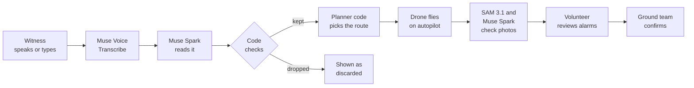
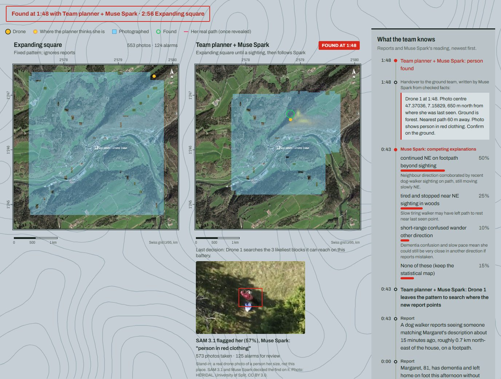
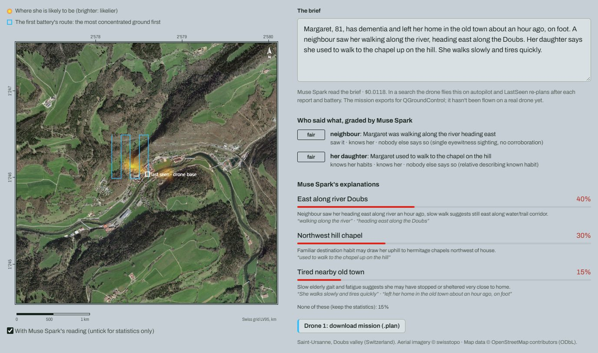
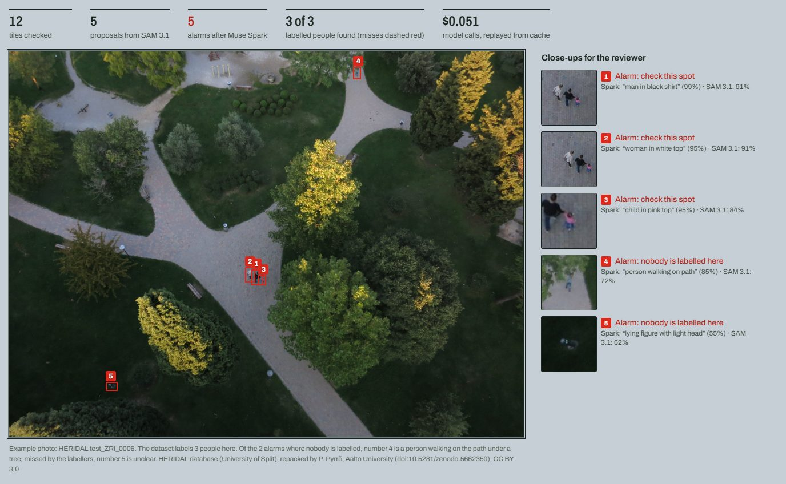
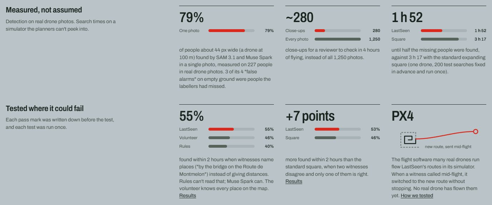

# LastSeen

> Meta Global AI Developer Hackathon 2026 · Push the Frontier · built 27 Oct - 4 Nov 2026

LastSeen flies a search drone for a missing person and decides where it looks. Planning a drone search is still
"more art than science"
([MIT Technology Review, 2024](https://www.technologyreview.com/2024/05/30/1092988/ai-directed-drones-could-help-find-lost-hikers-faster/)):
what witnesses say reaches the search map by hand, or not at all. Search drones already fly their routes
automatically, but inside an area someone draws by hand beforehand; when new information comes in mid-search, the
drone is recalled and the area redrawn. LastSeen closes that gap. Muse Spark turns every report into weighted, checked
scenarios in seconds. The drone re-plans from them and flies the search itself,
breaking off its pattern mid-flight to follow a sighting. SAM 3.1 and Muse Spark check every photo for a person a few
dozen pixels wide, so a reviewer sees about 280 close-ups instead of 1,250 photos. One volunteer launches it, swaps
batteries and stays in command.

**In simulation, on 200 searches fixed in advance, half the missing people were found by 1 h 52 instead of 3 h 17**
with the standard expanding square ([how we measured](docs/evaluation.md)). It hasn't flown a real drone yet; PX4, the autopilot many real drones run, has flown its missions in simulation,
including a change of route sent mid-flight ([docs/px4-sitl.md](docs/px4-sitl.md)).

It is built for searches where minutes matter most: an older person with dementia who has walked away from home,
with one volunteer and one drone. Six in ten people living with dementia wander at least once
([Alzheimer's Association](https://www.alz.org/help-support/caregiving/stages-behaviors/wandering)); in the published
records 95% of those found within 24 hours are alive, against 60% after 48 hours, and only 1% answer when searchers
call out ([Koester, *Lost Person Behavior*](https://www.dbs-sar.com/LPB/Dementia.pdf)). Every search-time claim is
tested on a simulator built for it.

### For judges: 3 minutes
1. [Watch the dog walker's call come in](https://hishamalpha00--lastseen-web.us-east.modal.run/?race=saint-ursanne-dementia-19-spiral-hedge-spark-1drone&t=40):
   the drone on the right leaves its square 44 minutes into the search and finds her at 1 h 48; the square alone
   takes 2 h 56.
2. [Read a brief with Muse Spark](https://hishamalpha00--lastseen-web.us-east.modal.run/#brief): type or say what the family said, and watch it become weighted places
   on a real map in seconds.
3. [Be the witness on a place you know](https://hishamalpha00--lastseen-web.us-east.modal.run/#place): mark where she was seen, say the call in your own words, and
   watch the drone follow it (about a minute).
4. [Read the plan written before the test](docs/evaluation.md), then the result in [In numbers](#in-numbers).

The races are recorded simulator runs on real maps and real drone photos; reading a brief, checking your own photo and
the witness call are live calls to Meta's models. The hosted page runs one model job at a time, up to 60 an hour per
visitor; if it says it is busy, try again in a few seconds. The races never wait on a model. Or run it yourself:
[Run it](#run-it).


## What search experts told us
We wrote to people who study and fly drone searches. Four answered our questions, and their answers shaped LastSeen:
- **Witnesses or statistics?** "These two sources of information are not mutually exclusive; rather, they complement
  each other." (Antonio Miguel Cruz, University of Alberta). LastSeen blends both into one probability map.
- **Does the map change mid-search?** Jan-Hendrik Ewers (University of Glasgow) told us his drone-search planner
  "assumes that the underlying [probability map] is static." LastSeen re-plans mid-flight when a report changes it.
- **How reliable are sightings?** "From my own SAR experience I would say the vast majority [of sightings] have nothing
  to do with the subject." (Robert J. Koester, dbS Productions). So the team planner hedges: when a sighting was wrong,
  it still did as well as the standard pattern, and the demo includes a search where the sighting is wrong.
- **What happens today?** A rescue service that flies search drones described current practice: the drone flies
  automatically inside an area drawn by hand, and new information means recalling it and redrawing the area.

## How a search runs
The volunteer types or says what the family told them and launches the drone. From then on the search runs itself:
- the drone flies each battery's search on autopilot at 100 m;
- each photo goes to SAM 3.1 and Muse Spark as it is taken, and only the alarms reach a person, as close-ups;
- each witness report goes to Muse Spark, and the drone's next leg is planned from the updated map, mid-flight if
  needed;
- when the battery runs low the drone flies home, the volunteer swaps it, and the search carries on.

The volunteer stays in command, as EU drone rules require, and the ground team confirms any find. LastSeen is designed
around the radio link a drone keeps with its base, which is how a new leg reaches it mid-flight. LastSeen also expects each photo back as it is taken: in
the simulator's flight plan that is one photo of about 5 MB every 10 seconds, around 4 Mbit/s. Some enterprise drones
can send photos during flight, and on others a small onboard computer with a 4G modem can. Where photos only come off
after landing, a find waits for the battery swap, up to 25 minutes.

The simulator runs this loop end to end. What isn't built is LastSeen's connection to a real drone: each battery's
mission exports as a QGroundControl file instead of going over the radio link, and nothing receives photos from a drone
yet. In PX4's simulator the exported missions fly as planned, and a new leg uploaded while the drone is airborne takes
over without it stopping ([docs/px4-sitl.md](docs/px4-sitl.md)).

## Who decides what
Muse Spark decides what the words mean; code decides every number that follows; the volunteer and the ground team
decide what is true.



What code checks, and the test that holds it to that (`tests/test_agent.py`, `tests/test_perception.py`):
- Every place Muse Spark proposes must quote words that really appear in the reports or the map, or it is dropped:
  no invented evidence (`test_invented_evidence_is_dropped_and_rest_keeps_a_minimum_share`,
  `test_evidence_must_quote_the_reports_or_the_map_not_our_time_stamps`).
- Distances, spreads and weights are clamped to sensible ranges, at most 5 places are kept, and at least 15% of the
  weight always stays on "none of these", because witnesses are often wrong (`test_out_of_range_numbers_are_clamped`).
- A place that covers nothing inside the search area is dropped, and the dropped ones are shown, not hidden.
- If Spark fails or answers off the schema, the search carries on from the statistics
  (`test_advisor_carries_on_when_spark_fails`, `test_advisor_carries_on_when_spark_answers_off_schema`).
- Witness grades must quote the brief and use our labels; they are shown, not used to change weights
  (`test_witness_grades_must_quote_the_brief_and_use_our_labels`).
- The ground team's handover may only repeat facts from the race; any other number or direction rejects it
  (`test_handover_facts_come_from_the_race_and_the_message_may_only_repeat_them`).
- A find needs an alarm on the person, not just near them
  (`test_a_find_needs_the_alarm_on_the_person_and_cut_off_people_are_not_false_alarms`). The route is planned by
  code, never by the model.

## In numbers
- **79%** of people about 44 px wide (a drone at 100 m) are found in a single photo by SAM 3.1 + Muse Spark, measured
  on 227 labelled people in real drone photos (95% interval 70-86%, resampling whole photos: `ci95_photos` in
  `data/pod_table.json`).
- **3 of the 4 "false alarms"** SAM 3.1 + Muse Spark raised on 320 tiles of empty ground were real people the
  dataset's labellers had missed, so the measured false-alarm rate (about 1 per 100 tiles) is pessimistic.
- **About 280 close-ups instead of 1,250 photos** for a reviewer in 4 hours of one-drone flying. A mountain-rescue
  team reports 5 to 45 seconds to look through one full photo
  ([Gotovac et al., 2020](https://doi.org/10.3390/rs12203295)), so 1,250 photos are about 2 to 16 hours of looking; a
  close-up is one spot to accept or reject (not timed yet).
- **Under a cent** for Muse Spark to read a brief or a new report. Checking every photo of 4 hours of flying costs
  about $90 at today's prices (about 7 cents a photo), and turns those 2 to 16 hours of looking into about 280
  close-ups.
- **Half found by 1 h 52 instead of 3 h 17**, an hour and 25 minutes sooner than the expanding square alone, and
  **51% found within 2 hours instead of 44.5%** (+6.5 points, 95% interval +3 to +10.5). Measured on 200 held-out
  scenarios, fixed in advance and run once (one drone, photo mode). Muse Spark reads the witness reports, and when
  someone reports a sighting the drone breaks off its square to follow Spark's reading; when the sighting was wrong,
  it still did as well as the square. Spark's reading lifts even the standard pattern: restarted where Spark points,
  the square found 51.5% (+7 points, +3 to +11). A careful volunteer who restarts the square where the witness said
  found 49%. On development scenarios the gain held when the reports were reworded the way people talk ("a 20-minute
  walk", "NE-ish", witnesses who aren't sure): 52% against 53% with plain sentences. Every number, and the plan
  written before the run: [docs/evaluation.md](docs/evaluation.md).
- **When witnesses name a place instead, Muse Spark keeps the gain and rules lose it.** On the real valley, with
  each sighting given as a place ("by the bridge on the Route de Montmelon"), LastSeen found 55% within 2 hours
  against 40% for the expanding square (+14.6 points, +8.3 to +21.5). Rules written for the simulator's sentences drop
  to the square's 40%, and a volunteer who knows every named place on the map finds 46%. When two witnesses disagree
  and only one is right, LastSeen still beats the square by 7 points (+1.6 to +12.6). Both are development checks
  with pass marks written before the run ([docs/evaluation.md](docs/evaluation.md#named-places-and-witnesses-who-disagree-development-checks-3-nov)).

## Why it is built this way
| What we found | What LastSeen does |
|---|---|
| SAM 3.1 alone raised about one false alarm per 10 tiles; Spark's close-up check cut that by 37% and lost 7 of 662 people | Muse Spark checks every SAM proposal on a close-up before a person sees it |
| A mountain-rescue team takes 5 to 45 seconds to look through one full photo ([Gotovac et al., 2020](https://doi.org/10.3390/rs12203295)) | Only alarms reach the volunteer, as close-ups: about 280 instead of 1,250 photos |
| Most sightings have nothing to do with the missing person (Robert J. Koester, above) | The drone keeps its square until a sighting, and 15% of the weight always stays on "none of these"; when a sighting was wrong, it did as well as the square |
| Drone-search planners assume the map doesn't change, and today a new report means recalling the drone (above) | The route is re-planned after every report, mid-flight; PX4 takes the new leg without stopping |
| Rules written for the simulator's sentences fell to the square's 40% when witnesses named places instead | Muse Spark reads the words against the named places on the map: 55% |
| Baseten doesn't enforce the JSON schema for Muse Spark Open, and some answers ran past the token limit | Code checks every field on either backend, and a cut-off answer is asked again with twice the budget: all 301 readings came back usable |
| The planners had to be compared on 200 searches in a plan fixed in advance | The route is code, never the model, and every model answer is cached, so any run replays exactly, for $0 |

## What it does
- **Is anyone in this photo?** SAM 3.1 proposes possible people in each 1000 px tile of a drone photo, and Muse Spark
  checks each proposal on a close-up. A reviewer checks a few alarms instead of every photo.
- **Start a search here.** Type or speak what the family and witnesses said. Muse Voice Transcribe writes it down,
  and Muse Spark turns it into weighted hypotheses on a real map, using the named places on it ("the chapel up on the
  hill"). Spark also grades each witness the way a search manager would (do they know her, did they see it
  themselves, does anyone back it up?); the grades are shown, not used to change weights. LastSeen plans the drone's first
  battery, downloadable as a QGroundControl mission (flown by PX4 in its simulator; not yet on a real drone).
- **Watch a search.** Replays of the same search flown by different planners, on synthetic maps or a real valley
  (Saint-Ursanne, Switzerland), with the person hidden until the end. Every photo that had the person in it was
  decided by a real SAM 3.1 + Spark answer on a real drone photo of a person that size (in forest, canopy also hides
  them at an assumed rate, since the photos have no one under trees).
- **Try it on any place.** Click a point on the map and LastSeen builds a 3 km search area from OpenStreetMap. Be the
  witness: mark where she was seen and type or say the call in your own words. The test subject walks to your mark,
  arriving 5 minutes before the call; Muse Voice Transcribe writes the call down, Muse Spark reads only the words
  (never the mark), and the team planner's drone breaks off for where Spark points.

## Screenshots
Captured from the page with recorded answers, so no model was called.

| | |
|---|---|
| <br>**The find**: SAM 3.1 flagged her on a real drone photo, Muse Spark confirmed it and wrote the ground team's handover from facts code checked | <br>**Start a search**: Muse Spark grades each witness and turns the brief into weighted places, each quoting the words it rests on; the first battery's route downloads for QGroundControl |
| <br>**Is anyone in this photo?** SAM 3.1 proposes, Muse Spark checks each close-up, and the reviewer sees only the alarms | <br>**Measured, not assumed**: the headline numbers, each linked to how it was measured |

## Meta models
| Model | Job |
|---|---|
| SAM 3.1 | Finds people in drone photos (text prompt "person", boxes with confidence) |
| Muse Spark | Checks each SAM proposal on a close-up; reads briefs and witness reports into hypotheses, as strict JSON whose quotes and numbers code then checks |
| Muse Voice Transcribe | Turns a spoken brief or a witness's call into text |
| Muse Spark Open | Spark's jobs on open weights, served by Baseten (`SPARK_BACKEND=open`) |

Each model's calling code, prompts, measured result and cost, and why we don't use Muse Wonder or Muse Image:
[docs/meta-models.md](docs/meta-models.md).

Why these: SAM 3.1 finds people from the single word "person", with no training on our photos, so we measured it
instead of training anything (660 labelled people). Muse Spark answers as strict JSON against a schema, so every
quote, number and place it gives is checked by code before it touches the map, and the witness grades and the
ground-team handover need judgement a rule can't make. Muse Voice Transcribe lets a volunteer with cold hands talk
instead of type. Muse Spark Open means a team isn't tied to one hosted API: on its own it also beats the standard pattern, half
found by 2 h 05 instead of 3 h 17 (below).

**Open weights.** With `SPARK_BACKEND=open`, every Spark call goes to Muse Spark Open, Meta's open-weight model, on
Baseten. On the 200 held-out scenarios (one drone, photo mode), the team planner reading the reports with Muse Spark
Open found half by 2 h 05 instead of 3 h 17 with the expanding square, and 49.5% within 2 h against 44.5% (+5
points, 95% interval +1 to +9); the square restarted on its reading found 51.5%, the same as with Muse Spark. This
run was added after the evaluation plan ([results](docs/results/final-open-weights.txt)). All 301 readings came back without an error, and our checks matter more here because Baseten
doesn't enforce the JSON schema for this model; an answer cut off at the token limit is asked again with twice the
budget. On the photo check's test tiles, SAM 3.1 + Muse Spark
Open found 177 of 265 people and Muse Spark 179, with the same false-alarm rate (`python -m app.perception.gate_open`). On the page, "Use open
weights" reads a brief with Muse Spark Open, and the question box runs on Muse Spark Open for every visitor: it may
only return the ids of written answers, so an open-weight model routes the questions and never writes the text. Open weights mean a search team
isn't tied to one hosted API; we tested them through Baseten, not on our own hardware.

## How we know whether it works
- **Detection is measured, not assumed.** SAM 3.1 + Spark ran on 660 labelled people in the HERIDAL test photos and on
  empty ground; the simulator uses the measured rates by person size (`data/pod_table.json`).
- **The simulator can't grade its own homework.** Planners search with published lost-person statistics, while the
  hidden person follows behaviour rules; stress tests make the person behave unlike those statistics.
- **The hidden person walks as far as real ones.** The walk's speed, drift and moving time were fitted so that, over
  1,000 simulated walks, the distances people with dementia end up from where they were last seen match the published
  records: median 0.79 km against 0.80 km, and within 5% at the 25th and 75th percentiles (`python -m
  app.sar.walker_check`). The simulated person ends up farther from paths than the published average (most real
  subjects are found within about 70 m of one). That is the search a drone is for: someone near a path is usually
  found by searchers walking it, and the drone is needed once they have left the paths.
- **The final comparison is fixed in advance** ([docs/evaluation.md](docs/evaluation.md)): 200 unseen scenarios,
  one primary endpoint, and wording rules for the result whatever it shows.
- **Every parameter has a source and a sensitivity run** ([docs/parameters.md](docs/parameters.md)).
- **73 tests run in CI without a single model call**, with the GitHub Actions pinned to commit SHAs. Every model
  answer is cached under a hash of its request, so a bench, a replay or the demo reruns for $0 and offline.

## Before anyone relies on it
- The searches are simulated: the map and photos are real, the hidden person's walk is not. Limits are listed in
  [docs/evaluation.md](docs/evaluation.md#known-limits).
- Mission heights are 100 m above the take-off point, and the simulator doesn't model terrain height; over hills a
  real mission needs terrain-following heights (QGroundControl can adjust them).
- LastSeen isn't connected to a real drone yet: missions export as QGroundControl files for PX4 autopilots (flown in
  PX4's simulator, not on a drone), and nothing receives photos in flight. Where a drone can't send photos in flight, a find waits for the
  battery swap, up to 25 minutes later.
- Next: connecting to a real drone's radio link, a test flight over open ground, and a trial with a volunteer search team on a training exercise.

## Run it
```bash
uv sync
cp .env.example .env          # add MODEL_API_KEY for live model calls
uv run uvicorn app.main:app --reload
uv run pytest
```
Open http://localhost:8000. A fresh clone already shows the three featured races with their find photos, the example
brief and the example photo check: their files are committed (`data/runs`, `data/briefs`, `data/triage` and the 7
photo tiles in `data/tiles`). Reading a new brief, checking your own photo and a race on a new place call the models,
so they need `MODEL_API_KEY` and `LIVE_MODELS=1` in `.env`. With `RECORD_RACES=1` the page can also
record a race for any development seed, from cached readings only. The simulator and bench need no key:
```bash
uv run python -m app.sar.bench --planners lawnmower,spiral,greedy --seeds 40 --workers 4
uv run python -m app.sar.replay --seed 19 --place saint-ursanne --planners spiral,greedy
```
A `+spark` planner (e.g. `greedy+spark`) needs `MODEL_API_KEY` for Spark's readings, then replays them from the cache.

Optional data (downloaded, never committed): `uv run python -m app.perception.heridal` fetches the HERIDAL test
photos (about 0.5 GB); `uv run python -m app.perception.gate` measures detection on them (paid, about $2.50); then
`uv run python -m app.perception.triage --example` and `uv run python -m app.agent.brief --example` build the page's
examples.

## Plug in a planner
A planner implements `app/sar/interface.py`: `reset` (the map, fleet, detection rates and statistics), `observe`
(photos that found nobody, witness reports, Spark's hypotheses, a drone that fails), `plan` (the next sortie for a
drone at base) and optionally `retask` (a new route for a drone in the air when a report comes in) and
`probability_map`. It never sees the hidden person. The team's planner, `hedge` (`app/planner/hedge.py`), flies the
expanding square until a witness reports a sighting, then sends one drone after Spark's reading of it with the map
planner `ours` (`app/planner/__init__.py`); `app/sar/planners/greedy.py` is a complete single-file example. Then:
```bash
uv run python -m app.sar.bench --planners hedge,ours,spiral,greedy --seeds 200 --drones 1 --workers 8
uv run python -m app.sar.bench --planners hedge,hedge+spark --seeds 200 --drones 1 --imagery   # with Spark's reading (paid once, then cached)
SPARK_BACKEND=open uv run python -m app.sar.bench --planners spiral,hedge+spark --seeds 200 --drones 1 --imagery   # on Muse Spark Open
uv run python -m app.sar.bench --planners hedge+spark,spiral+spark --seeds 200 --drones 1      # vs a spiral that restarts on Spark's readings
uv run python -m app.sar.bench --planners spiral,spiral+witness,hedge+spark --seeds 200 --drones 1 --imagery   # vs a volunteer who restarts where the witness said
uv run python -m app.sar.bench --planners spiral,hedge+spark --drones 3                        # three drones
uv run python -m app.sar.bench --planners spiral,hedge+spark --drones 3 --lose-drone           # one of three fails in the first 2 h
```

## Layout
```
app/sar/          simulator: maps, hidden person, arena, witness reports, baselines, bench, replays
app/agent/        Spark reads reports and briefs into hypotheses
app/perception/   SAM 3.1 + Spark on photos: calibration, photo pool, photo check
app/planner/      the team's planner (`hedge`) and the map planner it hunts with (`ours`)
app/main.py       web API;  static/  the page
docs/             evaluation plan, parameters, team workflow
```

## Data and credits
- Drone photos: HERIDAL database (University of Split), repacked by P. Pyrrö, Aalto University
  (doi:10.5281/zenodo.5662350), CC BY 3.0.
- Map data © OpenStreetMap contributors (ODbL). Aerial imagery © swisstopo, loaded by the browser from swisstopo
  (and in `static/race.jpg`).
- Lost-person statistics: Koester, *Lost Person Behavior* (ISRID data); Hashimoto et al. (2022); sources per number
  in `data/lost_person_stats.json`.

## Built during the hackathon
Commit `be7036a` is a generic FastAPI starter template written beforehand; it contains no project-specific code.
The two commits on 26 Oct, kickoff day, are setup only (model API routing, spend guard, team docs, licence). All
product code was written during the event, from 28 Oct.

Zhe, an accepted participant, wrote parts of the map planner (`app/planner/__init__.py`) and its tests early in the
week, then withdrew from the hackathon for personal reasons. Following the organisers' guidance, that code has been
rewritten from a description of what it does, and the project no longer contains any of his code. The rewritten
planner finds the person at the same time as before in every held-out scenario, so the results above are unchanged.
His original commits (`2f97915`, `cb5da38`, `67281a6`) remain in the git history.

## License
MIT
